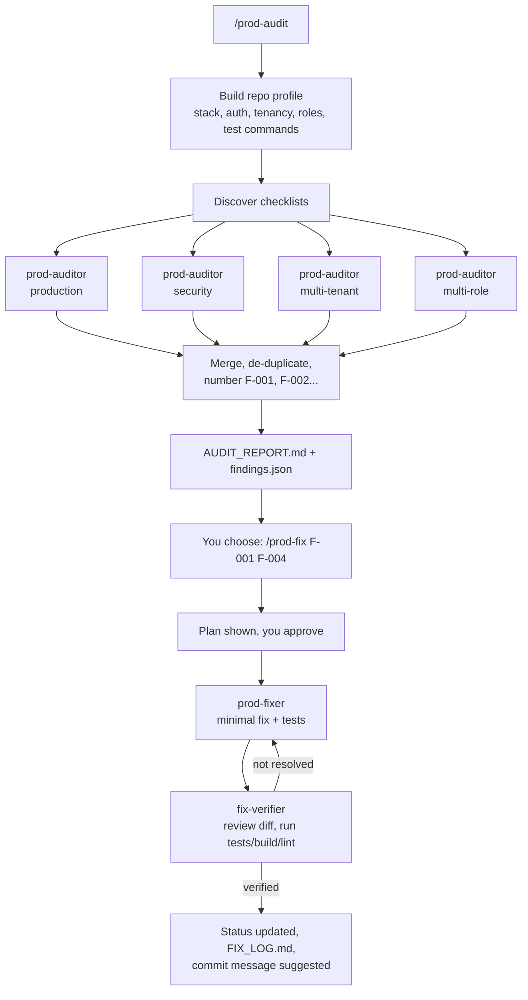

# Production Audit Kit for Claude Code

An end-to-end **audit → select → fix → verify** workflow for Claude Code. It scans your repository for production-readiness, security, multi-tenant, and multi-role (RBAC) problems, produces a numbered report, and fixes the issues you choose, with an independent verification step after every fix.

- 95 checks across 4 categories, all editable plain-text checklists
- 3 specialized agents: auditor, fixer, verifier
- 2 commands: `/prod-audit` and `/prod-fix`
- Audits the current code, a single commit, a commit range, or the code as it was at any past commit
- Never commits, pushes, or touches your database

---

## Table of contents

1. [The problem it solves](#1-the-problem-it-solves)
2. [How it helps](#2-how-it-helps)
3. [What it checks](#3-what-it-checks)
4. [How it works](#4-how-it-works)
5. [Requirements](#5-requirements)
6. [Installation](#6-installation)
7. [Quick start](#7-quick-start)
8. [Running an audit](#8-running-an-audit)
9. [Fixing issues](#9-fixing-issues)
10. [Auditing a specific commit](#10-auditing-a-specific-commit)
11. [Example walkthrough](#11-example-walkthrough)
12. [Output files](#12-output-files)
13. [Customizing and extending](#13-customizing-and-extending)
14. [Saving tokens](#14-saving-tokens)
15. [Safety: what the agents will never do](#15-safety-what-the-agents-will-never-do)
16. [Limitations](#16-limitations)
17. [Troubleshooting](#17-troubleshooting)
18. [FAQ](#18-faq)
19. [File reference](#19-file-reference)
20. [For maintainers: releasing a new version](#20-for-maintainers-releasing-a-new-version)

---

## 1. The problem it solves

Many serious production bugs are not syntax errors or failing tests. They are gaps that only appear under real-world conditions: multiple users, retries, many tenants, different roles.

**A real example.** In a training-management app, several admins can book a trainer for an employee. When an admin selects a trainer and a date, the app calls an availability API. But the availability check only *reads* data; it doesn't reserve the slot. Two admins checking the same trainer at the same moment both see "available," both book, and the trainer is double-booked.

Code review rarely catches this, because each request looks correct on its own. Tests rarely catch it, because tests usually run one request at a time. It shows up only in production.

The same family of hidden problems includes:

- **Concurrency:** double booking, lost updates when two admins edit the same record, duplicate payments from double-clicks
- **Security:** a user changing `/bookings/123` to `/bookings/124` and seeing someone else's data, tokens not verified in a sub-app, secrets committed to git
- **Multi-tenancy:** one missing `WHERE tenant_id = ?` that leaks one company's data to another, caches shared across tenants, background jobs without tenant context
- **Roles and permissions:** permission checks only in the UI, admins able to grant themselves higher roles, two admins approving the same request at once

Checking for all of these manually, across a whole repository, every release, is slow and easy to skip. This kit makes it a repeatable command.

## 2. How it helps

| Without the kit | With the kit |
|---|---|
| Problems found by users in production | Problems found before release, with file and line |
| Review depends on who reviews and how much time they have | Same 95 checks every time, for every developer |
| "Fix the security issues" is vague | Each issue has an ID, severity, evidence, impact, and a recommended fix |
| Fixes may break something else | Every fix is independently verified with tests, build, and lint |
| No record of what was checked or fixed | Report, findings history, and fix log stored in the repo |
| Hard to know when a vulnerability entered the code | Audit any past commit or range, with "introduced in" and "still present?" info |
| Checklists live in a wiki nobody reads | Checklists are the input to the agent; update a file and every audit uses it |

**Who benefits**

- **Developers:** catch issues before code review, learn the "why" behind each finding.
- **Tech leads and reviewers:** a consistent baseline review on every pull request (`--since=main`).
- **Teams with many apps** (for example, a central SSO portal launching several sub-apps): install once globally and use the same checks in every repository and every VS Code window.
- **Security and compliance:** an audit trail of what was checked, found, fixed, and accepted as risk.

## 3. What it checks

| Category | Checks | Examples |
|---|---|---|
| **Production readiness** (`production`) | 30 | Double booking, lost updates, double submission, partial failures, time zones, overlap rules, timeouts and retries, safe migrations, N+1 queries, cache correctness, audit logs, DB constraints, status state machines, secrets in code |
| **Security** (`security`) | 26 | Password hashing, brute-force protection, token validation and SSO, server-side authorization, IDOR, mass assignment, SQL injection, XSS, CSRF, file uploads, SSRF, sensitive data in logs, CORS, security headers |
| **Multi-tenant** (`multi-tenant`) | 21 | Tenant filter on every query, tenant taken from the token not the request, tenant context in background jobs, tenant-aware cache keys, file isolation, per-tenant unique constraints, super-admin auditing, shared resources across tenants |
| **Multi-role / RBAC** (`multi-role`) | 18 | Permissions instead of hard-coded role names, scope (own / department / all), vertical and horizontal escalation, field-level access, role-assignment limits, last-admin protection, concurrent approvals, self-approval |

Each check has:

- an **ID** (for example `CONC-01`), shown in reports as `PROD-CONC-01`
- a **default severity**: critical, high, medium, or low
- a **kind**: `code` (verified in source) or `process` (cannot be proven from code, reported as a manual to-do, like "backups have been restore-tested")
- **Look for** hints and a **Pass** condition

Categories switch themselves off when they don't apply. For example, multi-tenant checks are reported as "not applicable" in a single-tenant app.

## 4. How it works



### Components

| Component | Type | Can edit code? | Role |
|---|---|---|---|
| `/prod-audit` | Skill (command) | No | Orchestrates the audit: profiles the repo, runs auditors in parallel, merges results, writes the report |
| `/prod-fix` | Skill (command) | Through the fixer | Orchestrates fixes: resolves your selection, shows a plan, runs fixer and verifier, updates statuses |
| `prod-auditor` | Agent | No (Read, Grep, Glob only) | Audits one checklist and returns findings as structured JSON |
| `prod-fixer` | Agent | Yes | Implements approved fixes following your repo's conventions, adds a new migration if needed, adds tests |
| `fix-verifier` | Agent | No | Independently reviews the diff, checks every location is fixed, looks for regressions, runs tests/build/lint |

**Why skills orchestrate and agents do the work.** Subagents run in their own context and cannot ask you questions or start other subagents. So the commands run in your main session, where they can ask you to choose and confirm, and they hand focused jobs to the agents. Keeping the auditor and verifier read-only means the only agent that changes code is the fixer, and only for findings you approved.

**Why a separate verifier.** An agent that wrote a fix tends to believe it works. The verifier didn't write it, reviews it skeptically, and runs the tests. If the fix is incomplete, the fixer gets one retry with the verifier's feedback; after that, the finding is handed back to you.

## 5. Requirements

- [Claude Code](https://docs.claude.com/en/docs/claude-code/overview) (terminal or VS Code extension)
- A git repository (required for `/prod-fix`, `--since`, `--at`, `--commit`, `--range`)
- Any language or framework. The auditor adapts its searches to your stack (for example .NET controllers and `[Authorize]`, Node routes and middleware, Angular/React guards and `innerHTML`).
- Optional: an `app.manifest.yaml` per app. If present, the audit records each app's auth mode (SSO, standalone, or none), so SSO checks apply only where relevant.

## 6. Installation

Replace `favas-techbiz/prod-audit-kit` below with the real repository path.

### 6.1 Recommended: install as a plugin

In Claude Code (terminal or VS Code), run:

```
/plugin marketplace add favas-techbiz/prod-audit-kit
/plugin install prod-audit-kit@prod-audit-tools
```

Restart Claude Code if asked. That's it: the agents and commands are available in every project.

- **Private repository:** the person installing needs read access to the repo and working git credentials on their machine (the same ones they use for `git clone`). SSH users can add it as `git@github.com:favas-techbiz/prod-audit-kit.git`.
- **Command names:** plugin commands are namespaced, so they may appear as `/prod-audit-kit:prod-audit` and `/prod-audit-kit:prod-fix`. Typing `/prod-audit` and picking from the autocomplete list works either way. This README uses the short names.
- **Get updates:** run `/plugin marketplace update prod-audit-tools`, then reinstall or update the plugin from the `/plugin` menu.
- **Remove:** use the `/plugin` menu, or `/plugin uninstall prod-audit-kit@prod-audit-tools`.

### 6.2 Install for a whole team automatically

To give everyone who works in a repository the marketplace without asking them to run commands, run this once from a shell in that repository and commit the `.claude/settings.json` it writes:

```bash
claude plugin marketplace add favas-techbiz/prod-audit-kit --scope project
```

Team members are then offered the marketplace when they open the project, and install the plugin from the `/plugin` menu.

### 6.3 Alternative: manual install (no plugin system)

Clone the repository and run the installer. It copies the agents and skills into your `.claude` folder and never touches your settings, history, or other agents.

Windows (PowerShell):
```powershell
git clone https://github.com/favas-techbiz/prod-audit-kit.git
cd prod-audit-kit
.\install\install.ps1                          # all projects (~\.claude)
.\install\install.ps1 -Project C:\path\to\repo  # or one project only
```
If PowerShell blocks the script, run it once with:
`powershell -ExecutionPolicy Bypass -File .\install\install.ps1`

macOS / Linux:
```bash
git clone https://github.com/favas-techbiz/prod-audit-kit.git
cd prod-audit-kit
./install/install.sh                   # all projects (~/.claude)
./install/install.sh /path/to/repo     # or one project only
```

To update: `git pull` in the cloned folder and run the installer again.

> **Never replace your whole `.claude` folder.** It holds your settings, other agents and skills, history, and possibly login data. The installer only replaces the kit's own files.

**Which wins if installed more than once?** Project files (`<repo>/.claude/`) win over personal files (`~/.claude/`), which win over the plugin. Avoid installing both the plugin and the manual copy, to keep things simple.

### 6.4 Verify

1. Restart Claude Code.
2. Type `/prod` and confirm `prod-audit` and `prod-fix` appear.
3. Ask Claude: *"Which custom subagents are available?"* You should see `prod-auditor`, `prod-fixer`, and `fix-verifier` (with a `prod-audit-kit:` prefix if installed as a plugin).

### 6.5 Optional: `.gitignore`

Results are written to `.prod-audit/` in each repository. Either add it to `.gitignore`, or commit it so the team can track findings and fixes together.

## 7. Quick start

```bash
git checkout -b prod-audit          # work on a branch so changes are easy to review
```

In Claude Code:

```
/prod-audit                         # 1. audit everything
                                    # 2. read .prod-audit/AUDIT_REPORT.md
/prod-fix critical                  # 3. fix all critical findings (you approve the plan first)
/prod-audit --since=main            # 4. re-check what changed
```

Then review the diff, run your app, and commit.

## 8. Running an audit

```
/prod-audit [paths...] [--only=<categories>] [--at=<commit> | --commit=<commit> | --range=<from>..<to> | --since=<ref>]
```

| Example | What it does |
|---|---|
| `/prod-audit` | Whole repository, all categories |
| `/prod-audit src/booking` | Only the booking module |
| `/prod-audit apps/portal apps/billing` | Several folders |
| `/prod-audit --only=security` | Only security checks |
| `/prod-audit --only=production,multi-role` | Two categories |
| `/prod-audit --since=main` | Only files changed compared with `main` (best for pull requests) |
| `/prod-audit --at=v1.2.0` | The whole code as it was at tag `v1.2.0` |
| `/prod-audit --commit=a1b2c3d` | Only what commit `a1b2c3d` changed |
| `/prod-audit --range=v1.2.0..a1b2c3d` | Everything changed from `v1.2.0` up to `a1b2c3d` |
| `/prod-audit src/booking --at=a1b2c3d --only=security` | Options combine |

**What you'll see in chat** (short, because the detail is in the report):

```
Audited: working tree · 4 critical · 9 high · 12 medium · 5 low · 6 manual

| ID    | Severity | Title                                           | Location                        |
|-------|----------|-------------------------------------------------|---------------------------------|
| F-001 | critical | Trainer booking checks then inserts separately  | src/booking/booking.service.ts:42-68 |
| F-002 | critical | Booking endpoint loads by ID without owner check| src/booking/booking.controller.ts:31 |
...
```

**Severity guide**

| Severity | Meaning |
|---|---|
| critical | Data leak, privilege escalation, data corruption, or money loss is likely. Fix before release. |
| high | Real risk under normal use or load. Fix soon. |
| medium | Weakness that increases risk or causes occasional problems. Plan a fix. |
| low | Improvement or best practice. |

**Confidence** (high / medium / low) tells you how sure the auditor is. Treat low-confidence findings as prompts for a human look, not as facts.

## 9. Fixing issues

```
/prod-fix [--report=<folder>] <selection>
```

| Example | What it does |
|---|---|
| `/prod-fix F-001 F-004` | Fix specific findings (`f1`, `1`, and `F-001` all work) |
| `/prod-fix critical` | All open critical findings |
| `/prod-fix high` | All open high **and** critical findings |
| `/prod-fix category:security` | All open findings in one category |
| `/prod-fix all` | Every open finding (batches are suggested if there are many) |
| `/prod-fix ignore F-010 "internal tool, accepted risk"` | Mark as accepted risk |
| `/prod-fix reopen F-010` | Undo an ignore |
| `/prod-fix` | Shows open critical/high findings and asks which to fix |
| `/prod-fix --report=commits/a1b2c3d F-002` | Fix a finding from a commit audit (applied to current code) |

**What happens**

1. **Safety check:** Claude checks `git status`. If you have uncommitted changes, it asks before continuing, and offers to create a branch.
2. **Plan:** for each finding, you see the approach, files likely to change, whether a migration is needed, and the risk. When there are real alternatives, you choose. For a double-booking issue, for example: a database exclusion/unique constraint, a row lock in a transaction, or a temporary HOLD status with expiry.
3. **Approval:** nothing is changed until you approve.
4. **Fix:** `prod-fixer` makes the smallest complete change, following your project's patterns, and adds tests.
5. **Verify:** `fix-verifier` reviews the diff and runs tests, build, and lint. If the fix is incomplete, the fixer gets one retry.
6. **Report:** a table of results, manual steps (for example "run the new migration" or "remove existing duplicate bookings first"), and a suggested commit message.

**Finding statuses**

| Status | Meaning |
|---|---|
| OPEN | Found and not yet fixed |
| IN_PROGRESS | Being fixed right now |
| FIXED | Fixed and verified |
| PARTIAL | Some locations fixed, some remain |
| NEEDS_ATTENTION | Fix failed verification twice; needs a human |
| IGNORED | Accepted risk, with your reason and the date |
| RESOLVED_UNVERIFIED | Was open last time, not found this time (perhaps fixed manually) |

Finding IDs stay the same across audits, so `F-003` today is still `F-003` next week. A fixed finding that comes back is reopened and marked `reopened`.

## 10. Auditing a specific commit

Use this to answer questions like *"Was the code vulnerable at release v1.2.0?"* or *"What did the last 20 commits introduce?"*

| Option | Meaning | Use when |
|---|---|---|
| `--at=<commit>` | Snapshot: the **whole code** as it was at that commit | Auditing a release, or code "up to" a commit |
| `--commit=<commit>` | Only what **one commit** changed | Reviewing a specific change |
| `--range=<from>..<to>` | Only what changed **between two commits** | Reviewing a sprint or release |
| `--since=<ref>` | Shorthand for `--range=<ref>..HEAD` | Pull requests |

Commits can be a SHA (`a1b2c3d`), tag (`v1.2.0`), branch (`release/2.0`), or relative ref (`HEAD~10`).

**How it works**

- **Your work is never touched.** For an older commit, Claude creates a temporary read-only copy with `git worktree` in `.prod-audit/worktrees/` and removes it afterwards. Your branch and uncommitted files stay as they are.
- **Change modes focus on the change.** Only problems in changed lines, or problems the change makes reachable, are reported. Each finding records the commit that introduced it (`introduced_in`).
- **Separate reports.** Saved to `.prod-audit/commits/<sha>/` or `.prod-audit/ranges/<from>..<to>/`, so your main report isn't overwritten.
- **"Still in current code?"** Each finding is checked against today's code (`still_present`: yes / no / unknown).
- **Fixes go into today's code.** `/prod-fix --report=commits/<sha> F-002` fixes the current code. Findings already fixed in later commits are skipped.

## 11. Example walkthrough

**Situation:** admins report that the same trainer was booked twice for the same time.

**1. Audit the booking module**
```
/prod-audit src/booking --only=production
```

**2. The report shows**
```
F-001 · critical · PROD-CONC-01 · confidence: high
Trainer booking checks availability and inserts in separate steps
Location: src/booking/booking.service.ts:42-68
Evidence: checkAvailability() runs a SELECT, then createBooking() runs an INSERT
          in a separate call with no transaction, lock, or constraint.
Impact:   Two admins booking the same trainer at the same time both succeed.
Fix:      Add a database exclusion constraint on (trainer_id, time range) for
          HELD/CONFIRMED bookings and return 409 SLOT_ALREADY_BOOKED on conflict.
          Alternatives: row lock in a transaction; temporary HOLD with expiry.
Effort: medium · Needs migration: yes
```

**3. Fix it**
```
/prod-fix F-001
```
Claude shows the plan and asks you to choose the approach. You choose the database constraint. It warns that existing duplicate bookings must be cleaned up before the migration can apply.

**4. Result**
```
| ID    | Result | Files changed                                   | Tests  |
|-------|--------|-------------------------------------------------|--------|
| F-001 | FIXED  | booking.service.ts, booking.controller.ts,      | passed |
|       |        | migrations/20261120_no_trainer_overlap.sql,     |        |
|       |        | booking.service.spec.ts, booking-form.component |        |

Manual steps: remove existing overlapping bookings, then run the migration.
Suggested commit: fix(booking): prevent double booking of trainers with DB constraint
```

**5. Add a team rule so it never happens again** (see [section 13](#13-customizing-and-extending)): a `booking-rules` checklist with a check that slot status must change to HELD when selected.

## 12. Output files

Everything is written to `.prod-audit/` in your repository:

```
.prod-audit/
├── AUDIT_REPORT.md        # human-readable report for the current code
├── findings.json          # machine-readable findings with IDs and statuses
├── repo-profile.md        # detected stack, auth, tenancy, roles, test commands
├── FIX_LOG.md             # what was fixed, when, and how
├── history/               # previous reports
├── commits/<sha>/         # reports for --at audits (same file set)
├── ranges/<from>..<to>/   # reports for --commit, --range, --since audits
└── worktrees/             # temporary copies of old commits (removed after use)
```

**AUDIT_REPORT.md sections**

1. Header: what was audited (working tree, a commit, or a range)
2. Summary: counts by severity and category, and categories that don't apply
3. Findings by severity: ID, title, check, locations, impact, recommendation, effort, confidence
4. Manual checks: process items to confirm by hand
5. Passed checks: a short list per category

## 13. Customizing and extending

No agent changes are ever needed. The agents read the checklist files on every run.

### Where to put your own checks

Don't edit the built-in checklists inside the plugin or skill folder: updates replace them. Put your own checklist files in either of these folders instead. Every audit reads them automatically, and updates never touch them.

| Folder | Applies to |
|---|---|
| `~/.claude/prod-audit/checklists/` | All your projects |
| `<repo>/.claude/prod-audit/checklists/` | One project; commit it to share with the team |

If a custom file uses the same `category` as a built-in one (for example `production`), it **replaces** that built-in category. To **add** checks, use a new category name such as `booking-rules`.

### Add your own checks

Create, for example, `<repo>/.claude/prod-audit/checklists/booking-rules.md`:

```markdown
---
category: booking-rules
prefix: BOOK
title: Booking rules
applies_when: the repo has trainer or session booking
---

## Slot handling

### SLOT-01 | high | code — Booking slot status not updated on selection
Check: when a trainer slot is selected, its status changes (AVAILABLE → HELD) atomically so other admins cannot pick it.
Look for: availability API that only reads data; booking flows that never set HELD/RESERVED; no expiry job for held slots.
Pass: status updated in the same transaction or conditional update as the check, with a hold expiry job.
```

Rules:

- Header format: `### <ID> | <critical|high|medium|low> | <code|process> — <title>`
- Use the next free number in a section. Never reuse or renumber IDs; reports use them to track findings over time.
- Make **Look for** concrete: function names, patterns, file types. It's what makes the auditor accurate.

### More category ideas

Any new file works the same way, for example `api-design.md`:

```markdown
---
category: api-design
prefix: API
title: API design
applies_when: the repo exposes HTTP APIs
---

## Versioning

### VER-01 | medium | code — API versioning
Check: public APIs are versioned.
Look for: routes without /v1 or a version header.
Pass: all public routes carry a version.
```

It's picked up automatically. Run it alone with `/prod-audit --only=api-design`.

Ideas for more categories: `api-design`, `testing`, `ci-cd`, `frontend`, `accessibility`, `compliance`, or a `booking-rules` file with your own domain rules.

### Test a new check

```
/prod-audit src/booking --only=booking-rules
```

Confirm your check ID appears. If it misses the problem or flags too much, make **Look for** more specific.

### Shortcut

Ask Claude Code: *"Add a check to .claude/prod-audit/checklists/booking-rules.md: <your rule>. Use the next free ID and the same format as the prod-audit checklists."* Review the result before saving.

## 14. Saving tokens

| Tip | Saving |
|---|---|
| Scope the audit: `--since=main`, folder paths, `--only=` | Largest |
| Set `model: sonnet` in `prod-auditor.md` and `fix-verifier.md`; keep the fixer on your main model | Large |
| Add `maxTurns: 40` (auditor) and `maxTurns: 25` (verifier) to cap runaway runs | Prevents waste |
| Run `/clear` between `/prod-audit` and `/prod-fix`; the state is saved in `findings.json` | Medium |
| Fix in small batches of related findings instead of `/prod-fix all` | Medium |
| Keep agent descriptions short; they are loaded in every session | Small but constant |

Full audits are worth running before releases. For daily work, `--since=main` is usually enough.

## 15. Safety: what the agents will never do

- **Never commit, push, or switch your branch.** A branch is created only if you agree. You review and commit.
- **Never change code without your approval** of the plan.
- **Never edit already-applied migrations or run migrations** against any database. New migrations are created as files only.
- **Never install dependencies or write real secrets.** If a fix needs one, it stops and asks you.
- **Never delete tests or code to make checks pass.**
- **Never check out an old commit in your working tree.** Commit audits use a temporary worktree.
- Auditor and verifier are **read-only** by tool configuration.

## 16. Limitations

- **It's a static review, not a running test.** It reads code; it doesn't attack a live system. It complements, but doesn't replace, penetration testing, load testing, and dependency scanners.
- **False positives and misses happen.** Use the confidence level, and review every finding and fix like a colleague's pull request.
- **Process items can't be proven from code** (tested backups, alerts, penetration tests). They appear as manual to-dos.
- **Very large repositories** cost more tokens and time. Scope by app or folder.
- **Fixes involving design decisions** (for example, whether a trainer can be shared across tenants) need your input; the fixer will ask instead of guessing.
- Quality depends on the checklist. Better **Look for** hints give better results.

## 17. Troubleshooting

| Problem | Solution |
|---|---|
| `/prod-audit` doesn't appear | Restart Claude Code. Plugin: check it is installed and enabled in the `/plugin` menu. Manual: check `~/.claude/skills/prod-audit/SKILL.md` exists. Type `/prod` and look for a namespaced name like `/prod-audit-kit:prod-audit`. |
| Agents not found | Plugin: reinstall from the `/plugin` menu. Manual: check `~/.claude/agents/prod-auditor.md` exists and restart. |
| `/plugin marketplace add` fails | Check the repo path, that you have access (private repos), and that `git clone` of the repo works in your terminal. |
| Claude says it can't run the skill | Type the command explicitly, for example `/prod-fix F-001`. `/prod-fix` only runs when you invoke it. |
| "findings.json not found" in `/prod-fix` | Run `/prod-audit` first. For commit reports, pass `--report=commits/<sha>`. |
| A category says "not applicable" but should apply | Check `repo-profile.md`. If tenancy or roles were missed, describe them in your project's `CLAUDE.md` and re-run. |
| Too many low-value findings | Run with `--only=` and scope, or adjust the checklist's **Look for** lines. Use `/prod-fix ignore` for accepted risks. |
| Commit not found | Use `git log --oneline` to find the SHA; make sure you've fetched remote tags/branches. |
| Leftover worktree folder | Run `git worktree prune`, then delete `.prod-audit/worktrees/` if needed. |
| A fix shows NEEDS_ATTENTION | Read the verifier's reason in the chat or `FIX_LOG.md`, then fix manually or re-run with more guidance. |
| Lost my custom checks after updating | Keep custom checks in `~/.claude/prod-audit/checklists/` or `<repo>/.claude/prod-audit/checklists/`, never inside the plugin or skill folder. |

## 18. FAQ

**Does it work with my stack?**
Yes. The checks describe problems, not specific frameworks. The auditor reads your repo profile and adapts its searches to your languages and frameworks.

**Will it change my code without asking?**
No. `/prod-audit` is read-only. `/prod-fix` shows a plan and waits for your approval, and it never commits.

**Can I run it on a pull request?**
Yes: `/prod-audit --since=main` audits only the changes.

**How do I check whether a vulnerability existed in an old release?**
`/prod-audit --at=v1.2.0`. Each finding shows whether it still exists today.

**How do colleagues install it?**
They run `/plugin marketplace add favas-techbiz/prod-audit-kit` and `/plugin install prod-audit-kit@prod-audit-tools` (see [section 6](#6-installation)).

**Can my team share findings?**
Yes. Commit the `.prod-audit/` folder. IDs and statuses are stable across runs.

**What about apps that use SSO versus standalone login?**
If your apps have `app.manifest.yaml` with an `auth.mode`, the profile records it and SSO-specific checks apply only to SSO apps.

**Does it replace a security audit?**
No. It catches many common problems early and cheaply, so expert reviews can focus on deeper issues.

## 19. File reference

```
prod-audit-kit/                              # GitHub repository = plugin marketplace
├── .claude-plugin/
│   └── marketplace.json                     # marketplace "prod-audit-tools"
├── plugins/
│   └── prod-audit-kit/                      # the plugin
│       ├── .claude-plugin/
│       │   └── plugin.json                  # name and version
│       ├── agents/
│       │   ├── prod-auditor.md              # read-only auditor for one checklist
│       │   ├── prod-fixer.md                # implements approved fixes + tests
│       │   └── fix-verifier.md              # read-only verification of fixes
│       └── skills/
│           ├── prod-audit/
│           │   ├── SKILL.md                 # /prod-audit orchestrator
│           │   └── checklists/
│           │       ├── production.md        # 30 checks
│           │       ├── security.md          # 26 checks
│           │       ├── multi-tenant.md      # 21 checks
│           │       └── multi-role.md        # 18 checks
│           └── prod-fix/
│               └── SKILL.md                 # /prod-fix orchestrator
├── install/
│   ├── install.ps1                          # manual installer (Windows)
│   └── install.sh                           # manual installer (macOS/Linux)
├── CHANGELOG.md
└── README.md
```

## 20. For maintainers: releasing a new version

1. Make your changes under `plugins/prod-audit-kit/`.
2. Increase `version` in `plugins/prod-audit-kit/.claude-plugin/plugin.json` (for example `1.0.0` → `1.1.0`) and add a line to `CHANGELOG.md`.
3. Commit and push:
   ```bash
   git add .
   git commit -m "feat: <what changed>"
   git push
   ```
4. Optionally tag the release: `git tag v1.1.0 && git push --tags`.
5. Tell users to run `/plugin marketplace update prod-audit-tools` (plugin users) or `git pull` and the installer again (manual users).
